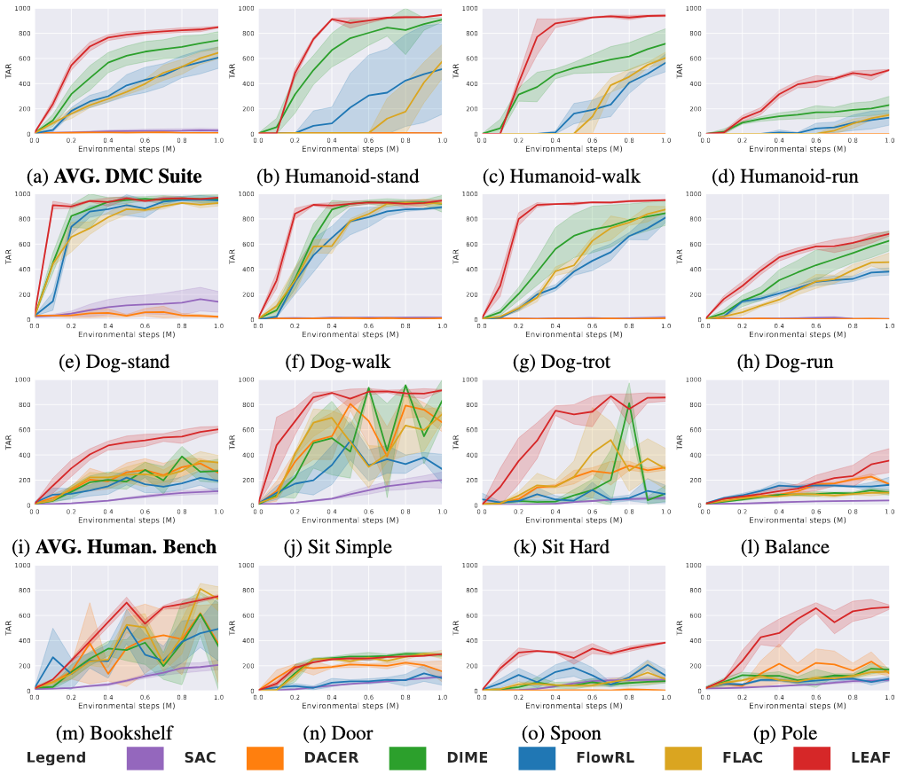
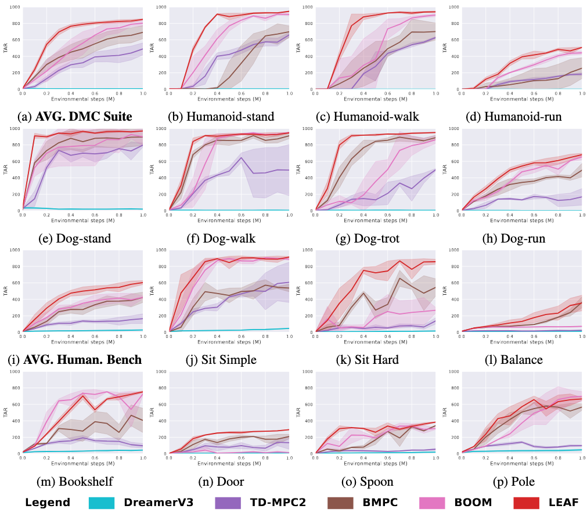

# [NeurIPS 2026] LEAF-Generative-Online-RL

This is the official implementation of **Look-ahead Variational Flow for Generative Online Reinforcement Learning (LEAF)**.

## Installation

A CUDA GPU is required. From the repository root:

```bash
conda create -n bmpc python=3.11 -y
conda activate bmpc
pip install -r requirements.txt
```

For HumanoidBench tasks, install [HumanoidBench](https://github.com/carlosferrazza/humanoid-bench) in the same environment:

```bash
git clone https://github.com/carlosferrazza/humanoid-bench.git ../humanoid-bench
pip install -e ../humanoid-bench
```

## Training

```bash
cd leaf
python train.py task=dog-run seed=1 steps=1000000
python train.py task=humanoid_h1hand-sit_simple-v0 seed=1 steps=1000000
```

Edit [`leaf/config.yaml`](leaf/config.yaml) for other settings. Checkpoints are saved under `leaf/logs/`. The root scripts `run_train.sh` and `run_train_parallel.sh` provide single-run and multi-run examples.

## Evaluation

To evaluate the flow policy with gradient refinement:

```bash
cd leaf
python evaluate.py task=dog-run checkpoint=/path/to/step_1000k.pt mpc=false num_flow_steps=1 use_score_guidance=true
```

For MPPI evaluation, use `mpc=true use_score_guidance=false`. Training uses MPPI for environment interaction; gradient refinement is used for policy evaluation.

## Tasks

| DMC Suite | HumanoidBench |
| --- | --- |
| `humanoid-stand` | `humanoid_h1hand-sit_simple-v0` |
| `humanoid-walk` | `humanoid_h1hand-sit_hard-v0` |
| `humanoid-run` | `humanoid_h1hand-balance_simple-v0` |
| `dog-stand` | `humanoid_h1hand-bookshelf_simple-v0` |
| `dog-walk` | `humanoid_h1hand-door-v0` |
| `dog-trot` | `humanoid_h1hand-spoon-v0` |
| `dog-run` | `humanoid_h1hand-pole-v0` |

## Results

Generative RL baselines:



Model-based RL baselines:




## Citation

```bibtex
@inproceedings{zhang2026leaf,
  title={Look-ahead Variational Flow for Generative Online Reinforcement Learning},
  author={Tianyi Zhang and Likun Wang and Tianze Zhu and Guojian Zhan and Yinuo Wang and Feihong Zhang and Yang Guan and Yao Lyu and Shengbo Eben Li},
  booktitle={Advances in Neural Information Processing Systems (NeurIPS)},
  year={2026}
}
```

## Acknowledgments

This implementation builds on [BMPC](https://openreview.net/forum?id=i7jAYFYDcM&noteId=TJpOFyUgv7) and [TD-MPC2](https://github.com/nicklashansen/tdmpc2). Humanoid tasks use [HumanoidBench](https://github.com/carlosferrazza/humanoid-bench).
